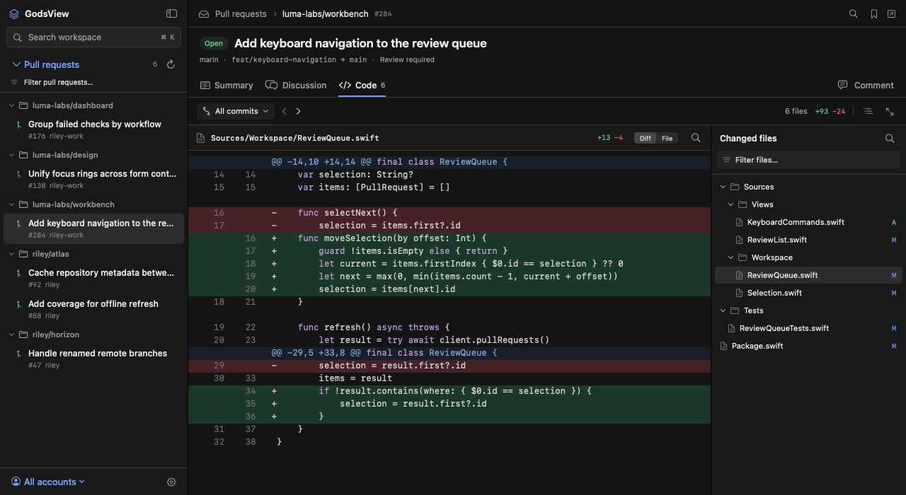

# GodsView

A native macOS inbox for pull requests across your GitHub CLI accounts. Pick an account in the sidebar or see them together. Each PR keeps its account identity through to the comment composer.



## Run on macOS

Requires macOS 14 or later, a current version of [GitHub CLI](https://cli.github.com/), and a GitHub.com login. To build from source, install Xcode 16 or newer, or its Command Line Tools with Swift 6.

```sh
brew install gh
gh auth login --hostname github.com --web
git clone https://github.com/yagyesh-bobde/godsview.git
cd godsview
./scripts/build-app.sh
open dist/GodsView.app
```

If you already use `gh`, GodsView discovers your existing accounts. To connect another identity, repeat the login command and refresh with **⌘R**. You can move the built app to Applications.

## Using the inbox

- Choose **Review requests**, **Authored by me**, or **Assigned to me**. A PR matching several queues appears once per account in the combined inbox.
- The sidebar groups PRs by repository. Filter by title, repository, author, account, or PR number.
- Select a PR to inspect its description, review decision, branches, labels, and change totals. **Discussion** loads the latest 20 conversation comments.
- Bookmark a PR to find it under **Saved** while it is in your open inbox. **Comment** shows the posting identity and accepts GitHub Markdown.
- Each refresh loads up to 50 recently updated open PRs per queue per account. The footer indicates when GitHub has more results. Click the external-link icon to open the full PR.

## Reviewing code

The **Code** tab opens with the PR diff and its changed-file tree. Select a path or filter the tree by name. Use **File** to read the complete UTF-8 blob for that revision, including the previous blob for deleted files when available. If GitHub omits a patch, the viewer offers the full file. GitHub limits a PR or commit file listing to 3,000 entries.

Choose **All commits** above the diff to search the PR history by message or SHA. Picking a commit shows its changes against its parent. The arrows beside the selector step through the history, retaining the selected path when it exists in the next commit.

| Shortcut | Action |
| --- | --- |
| ⌘K or ⇧⌘F | Search loaded PRs across accounts, commands, and the current review's paths and commits |
| ⌃⌥K | Bring GodsView forward and open search from another app while GodsView is running and the shortcut is available |
| ⌘P | Jump to a changed file in the current diff |
| ⇧⌘O | Search or switch commits |
| ⌥⌘← / ⌥⌘→ | Previous / next commit |
| ⌥⌘↑ / ⌥⌘↓ | Previous / next changed file |
| ⌘F | Find text inside the current patch or full file |
| ⇧⌘Return | Enter or leave the full-screen file viewer |
| ⌘B | Toggle the PR sidebar |

In a search palette, use the arrow keys to select, Return to open, and Escape to dismiss. The file-tree button also works in full-screen mode.

## Development

```sh
swift run GodsView
swift test
swift test -c release
```

The SwiftUI workspace and account state live in `Sources/GodsView`. `Sources/GitHubCore` owns GitHub CLI execution, per-account authentication, and API decoding. Account requests run concurrently. Each request obtains its credential from `gh` and passes it through the child process environment. The app keeps PR content in memory and stores saved PR identifiers in macOS preferences. Your global CLI account selection stays intact.

The repository sidebar, tabbed PR workspace, right-hand file tree, commit scope, and command palette follow the desktop review layout in [T3 Code](https://github.com/pingdotgg/t3code).
